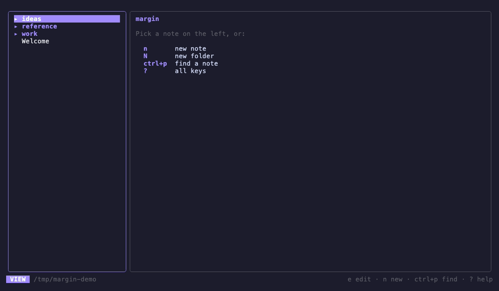
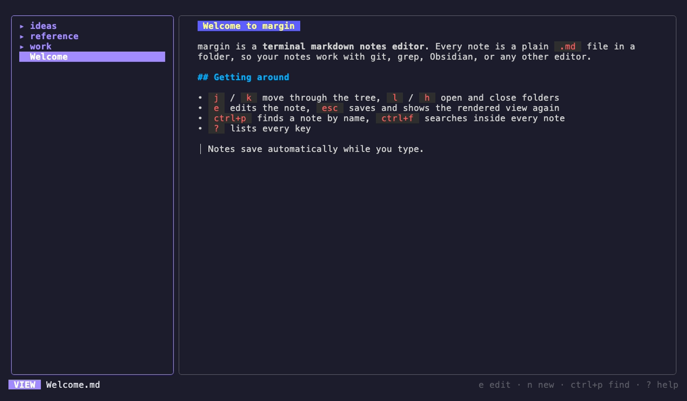
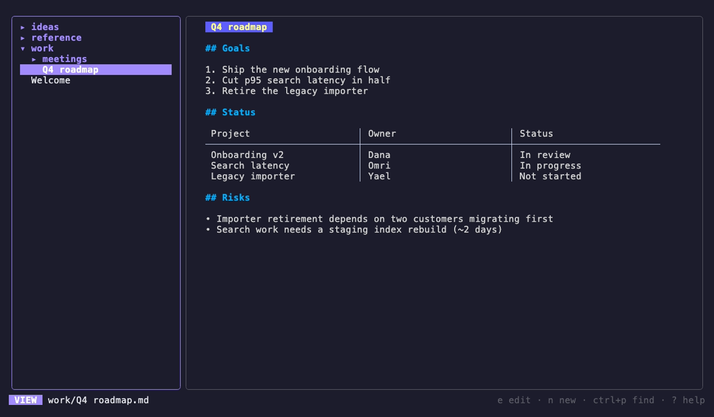
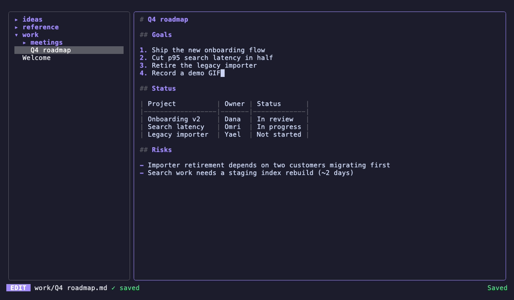
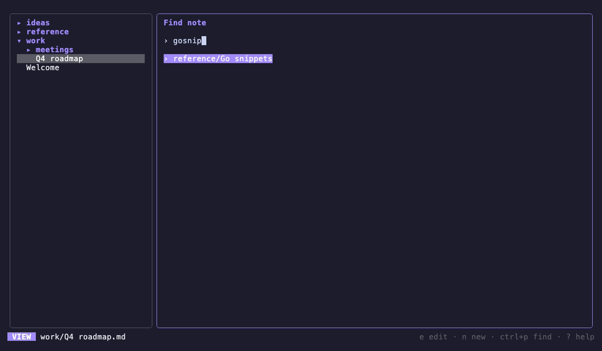
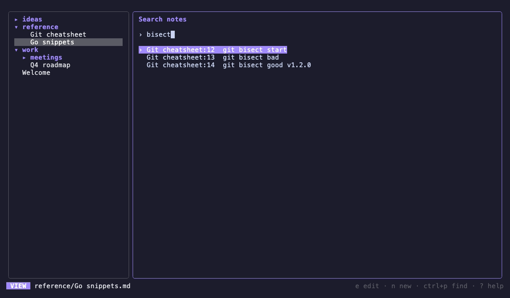
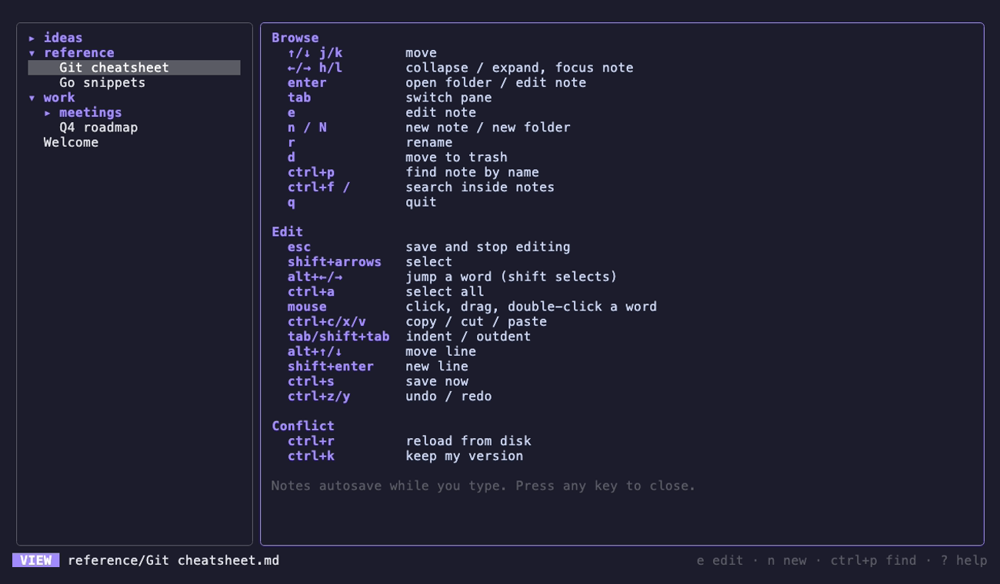

# margin

A terminal markdown notes editor. Your notes stay plain `.md` files in a folder, so they work with git, grep, Obsidian, or any other editor.



## Features

- **Folder tree** of your notes, with folders you can collapse
- **Rendered markdown** by default ([Glamour](https://github.com/charmbracelet/glamour)); press `e` to edit the raw text
- **Styled editing**: while you edit, headings, bold, code, links and colors are styled in place, with the markdown markers dimmed
- **A real editor**: select with shift+arrows or the mouse, copy/cut/paste with the system clipboard, word jumps, list continuation, indent/outdent, move lines
- **Colors**: `<span style="color:red">`, `<font color>` and `$\color{red}{\text{...}}$` render in color
- **Autosave** while you type; every write is atomic (temp file + rename)
- **Safe with other editors**: if a note changes on disk while you edit it, margin asks before overwriting
- **Fuzzy finder** (`ctrl+p`) by note name and **full-text search** (`ctrl+f`) across all notes
- **Trash** instead of delete: removed notes go to `<notes>/.trash/`
- Undo/redo, rename, folders, light/dark themes

## Screenshots

| Rendered note | Tables |
|---|---|
|  |  |
| **Editing (autosaved)** | **Fuzzy finder (`ctrl+p`)** |
|  |  |
| **Full-text search (`ctrl+f`)** | **Help (`?`)** |
|  |  |

## Install

```sh
go install github.com/beladevo/margin@latest
```

This puts `margin` in `$(go env GOPATH)/bin` (usually `~/go/bin`). If your shell can't find it, add that to your `PATH`:

```sh
echo 'export PATH="$PATH:$(go env GOPATH)/bin"' >> ~/.zshrc && source ~/.zshrc
```

Or download a binary from [Releases](https://github.com/beladevo/margin/releases).

## Usage

```sh
margin              # opens ~/notes (created if missing)
margin ~/vault      # opens another folder
```

### Try it on the examples

The repo ships a small notes folder in [`examples/notes`](examples/notes): meeting notes with task lists, a roadmap with a table, code snippets and a cheatsheet.

```sh
git clone https://github.com/beladevo/margin && cd margin
cp -r examples/notes /tmp/margin-examples   # edits autosave, so work on a copy
go run . /tmp/margin-examples
```

### Keys

| Browse | |
|---|---|
| `↑/↓` `j/k` | move |
| `←/→` `h/l` | collapse / expand, focus the note |
| `enter` | open folder / edit note |
| `tab` | switch pane |
| `e` | edit note |
| `n` / `N` | new note / new folder |
| `r` | rename |
| `d` | move to trash |
| `ctrl+p` | find note by name |
| `ctrl+f` or `/` | search inside notes |
| `?` | help |
| `q` | quit |

| Edit | |
|---|---|
| `esc` | save and go back to the rendered view (clears a selection first) |
| `shift+arrows`, `shift+home/end` | select |
| `alt+←/→` | jump a word (add `shift` to select) |
| `ctrl+a` | select all |
| mouse | click to place the cursor, drag to select, double-click a word |
| `ctrl+c` / `ctrl+x` / `ctrl+v` | copy / cut (whole line if nothing is selected) / paste |
| `alt+backspace` / `ctrl+w` | delete the previous word |
| `enter` / `shift+enter` | new line; lists and quotes continue, an empty item ends the list |
| `tab` / `shift+tab` | indent / outdent list items or the selected lines |
| `alt+↑/↓` | move the line or selected lines |
| `ctrl+s` | save now |
| `ctrl+z` / `ctrl+y` | undo / redo |

When a note changes on disk while you have unsaved edits, a banner appears: `ctrl+r` reloads the disk version, `ctrl+k` keeps yours.

New notes are named after their title: `Meeting notes` becomes `Meeting notes.md`, starting with `# Meeting notes`.

## Config

`~/.config/margin/config.toml` (or `$XDG_CONFIG_HOME/margin/config.toml`), all optional:

```toml
notes_dir = "~/notes"
theme = "auto"          # auto | dark | light
autosave_delay = "1s"
```

## Development

```sh
go test -race ./...
golangci-lint run
```

The GIF and screenshots are recorded with [vhs](https://github.com/charmbracelet/vhs):

```sh
vhs docs/demo.tape
```

## License

[MIT](LICENSE)
